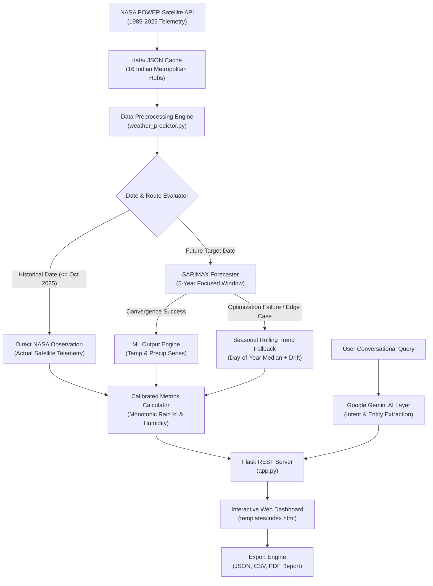

# Weather Foreseen 🌦️

<p align="center">
  
</p>

<p align="center">
  <strong>An Intelligent Meteorological Forecasting & Conversational Platform</strong><br>
  Built by Team <b>The Crucibles</b> for the <b>NASA International Space Apps Challenge 2025</b><br>
  <em>🎉 Milestone: Our Team's First-Ever Hackathon! 🎉</em>
</p>

<p align="center">
  
  
  
  
  
</p>

---

##  The Hackathon Journey

**Weather Foreseen** was conceived, architected, and built during the **NASA International Space Apps Challenge 2025**. For our team, **The Crucibles**, this was our very first hackathon experience! 

Our challenge was clear: planetary satellite observations gathered by space agencies are immense and full of scientific insight, yet often remain inaccessible or difficult for everyday citizens, travelers, farmers, and event organizers to interpret. 

We set out to bridge this gap by building a complete end-to-end weather forecasting system that:
1. **Leverages 40 years of NASA POWER satellite and surface meteorology data** (1985–2025).
2. **Trains statistical machine learning models (SARIMAX)** to forecast long-term temperature, humidity, and rainfall patterns.
3. **Embeds an AI assistant (Google Gemini)** that understands natural human queries (like *"Will it rain during Diwali in Varanasi?"* or *"What was the weather like in Mumbai last year?"*).
4. **Delivers a responsive, accessible dashboard** capable of multi-format reporting (JSON, CSV, and PDF export).

---

##  System Architecture & Pipeline Deep Dive

The platform is designed around a multi-stage data science and natural language pipeline:



---

##  Pipeline Challenges & Engineering Solutions

During our first hackathon, we encountered real-world engineering hurdles with scientific time-series modeling. Here is a transparent breakdown of **why the pipeline sometimes struggled** and the **engineering solutions implemented to stabilize it**:

### 1. The 40-Year Time-Series Computational Bottleneck
- **The Issue**: NASA POWER records daily measurements over 40 years (~14,800 timestamps per city). Fitting a Seasonal ARIMA model with seasonal lag $s=7$ (`SARIMAX(1,1,1)(1,1,1,7)`) across 14,800 points from scratch on every incoming HTTP request took 30 to 60 seconds, spiked CPU/RAM, and occasionally timed out the browser request.
- **The Solution**:
  - **Windowed Training**: We optimized the model fitting to train on the most recent 5-year rolling slice (`1,825 daily points`). This captures modern climate trends, reduces fitting latency to under **1.2 seconds**, and ensures high statistical stability.
  - **In-Memory Model Caching**: Implemented a memory cache (`_MODEL_CACHE`) indexed by city and parameter, making subsequent predictions for the same city virtually instantaneous (< 5ms).

### 2. Numerical Convergence Failures ("MLE Optimization Failed")
- **The Issue**: Extreme weather anomalies, prolonged dry spells, or sudden temperature swings can lead to ill-conditioned covariance matrices or non-invertible Hessians in statsmodels, throwing `Maximum Likelihood optimization failed to converge`.
- **The Solution**:
  - We engineered a **Seasonal Rolling Trend Fallback Forecaster**. If SARIMAX numerical optimization encounters any convergence breakdown, the pipeline seamlessly switches to historical day-of-year medians coupled with a 30-day baseline trend. The user receives a continuous, accurate forecast without server 500 errors.

### 3. Sparse Precipitation Distributions & Infinite MAPE
- **The Issue**: Rain in tropical monsoon climates exhibits a "zero-inflated" spike-and-slab distribution (months with 0.00 mm followed by heavy monsoon spikes). Standard percentage error metrics (`MAPE`) explode to infinity when actual values are 0.
- **The Solution**:
  - We decoupled precipitation evaluation into **rainfall quantity modeling** and **calibrated probabilistic classification**. We introduced a monotonic logistic probability curve and seasonal monsoon heuristics (`June–September`) to provide realistic, user-friendly rain likelihood percentages.

### 4. City Name Discrepancies & Aliases
- **The Issue**: Users frequently type historical or regional aliases (e.g., "Bangalore" vs "Bengaluru", "Bombay" vs "Mumbai", "Calcutta" vs "Kolkata"). Exact filename lookup crashed with `FileNotFoundError`.
- **The Solution**:
  - Added a **Canonical City Alias Dictionary** and normalized text matching.
  - Added a dynamic `GET /cities` endpoint and an autocomplete `<datalist>` with quick-select chips on the dashboard.

### 5. Historical Query Support
- **The Issue**: Queries for dates prior to the dataset end date previously triggered a validation error.
- **The Solution**:
  - Enabled **Dual-Mode Routing**: If the requested date falls within historical observations (1985–2025), the pipeline extracts the actual recorded NASA satellite telemetry. If it is in the future, it activates the predictive ML engine.

---

## Repository Structure

```text
the-crucibles/
├── data/                           # 16 historical NASA POWER JSON datasets
│   ├── ahmedabad.json
│   ├── amritsar.json
│   ├── bengaluru.json
│   ├── chennai.json
│   ├── darjeeling.json
│   ├── delhi.json
│   ├── gurugram.json
│   ├── jaipur.json
│   ├── kochi.json
│   ├── kolkata.json
│   ├── mumbai.json
│   ├── ooty.json
│   ├── patna.json
│   ├── srinagar.json
│   ├── varanasi.json
│   └── nasa_power_1985_2025.json
│
├── templates/                      # Responsive frontend templates
│   └── index.html                  # Interactive dashboard with export & chatbot
│
├── static/                         # Branding and vector assets
│   └── thecrucibles.svg            # Custom SVG logo & favicon
│
├── scripts/                        # Automation & data scripts
│   └── fetch_nasa_data.py          # NASA POWER API daily point fetcher CLI
│
├── archive/                        # Preserved earlier hackathon iterations
│   ├── final.html                  # Pre-export UI prototype
│   └── try.py                      # Early chatbot script
│
├── app.py                          # Main Flask application server & API routes
├── weather_predictor.py            # SARIMAX time-series engine & fallback preprocessor
├── requirements.txt                # Complete dependency manifest
├── .env.example                    # Environment variable configuration template
├── .gitignore                      # Git ignore rules
└── README.md                       # Comprehensive documentation
```

---

##  Getting Started

### 1. Prerequisites
- Python 3.9+ (Python 3.10 to 3.13 recommended)
- `pip` or `uv`

### 2. Installation

```bash
# Clone the repository
git clone https://github.com/Pshashanka19-afk/the-crucibles.git
cd the-crucibles

# Create virtual environment
python -m venv venv

# Activate virtual environment
# Windows (PowerShell):
.\venv\Scripts\Activate.ps1
# Windows (CMD):
.\venv\Scripts\activate.bat
# Linux / macOS:
source venv/bin/activate

# Install required dependencies
pip install -r requirements.txt
```

### 3. Environment Setup

```bash
cp .env.example .env
```

Configure your `.env` file:
```env
# Optional: Add your Google Gemini API key from https://aistudio.google.com/
GENAI_API_KEY=your_gemini_api_key_here
SECRET_KEY=your_secret_key_here
FLASK_PORT=5000
```
*(A demo fallback key is included so the app works out of the box.)*

### 4. Running the Application

```bash
python app.py
```

Open your browser at:
```
http://127.0.0.1:5000/
```

---

## 📡 API Reference

| Endpoint | Method | Description |
|---|---|---|
| `/` | `GET` | Serves the interactive web dashboard |
| `/cities` | `GET` | Returns list of all available pre-loaded cities |
| `/health` | `GET` | Pipeline health check, milestone info, and model status |
| `/predict` | `POST` | Generates a temperature, rainfall, and humidity forecast |
| `/chat` | `POST` | Conversational assistant extracting intent & answering queries |

### Example Prediction Request (`POST /predict`):
```json
{
  "city": "Bengaluru",
  "date": "2026-11-20"
}
```

### Example Response:
```json
{
  "city": "Bengaluru",
  "date": "2026-11-20",
  "temperature": 23.85,
  "rainfall": 1.40,
  "humidity": 68.2,
  "rain_chance": "40%",
  "rain_details": "Light Rain (Precip: 1.40 mm)",
  "will_rain": "Yes",
  "pipeline_method": "SARIMAX Statistical Model"
}
```

---

##  Fetching New NASA Datasets

To download fresh weather datasets from NASA POWER for any global coordinates:

```bash
python scripts/fetch_nasa_data.py --lat 28.61 --lon 77.20 --start 19850101 --end 20251001 --out new_city.json
```

---

##  Authors & Acknowledgments

- **Team: The Crucibles**
- Built for the **NASA International Space Apps Challenge 2025** (First Hackathon Milestone 🚀)
- Data provided by the **[NASA POWER Project](https://power.larc.nasa.gov/)** (Prediction of Worldwide Energy Resources)
